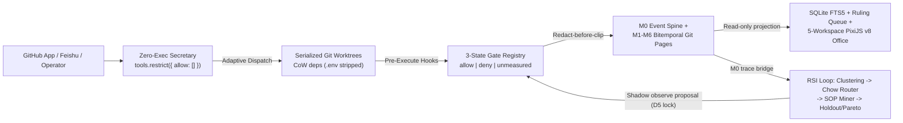

<p align="right">
  <strong>English</strong> · <a href="./README_ZH.md">简体中文</a>
</p>

# dsh-secretary

**Zero-trust autonomous coding agent harness** — append-only `M0–M6` bitemporal memory spine, three-state pre-execution gates (`allow | deny | unmeasured`), physically zero-execution secretary orchestration, statistical RSI self-improvement loop, and a 2:1 isometric PixiJS v8 telemetry campus.

> Re-architected on top of the MIT-licensed [DeepSeek Harness (DSH)](https://www.deepseek.com/en/harness/) bundle interface (`dsh-superagent` origin) with an independent verification, memory, isolation, RSI, and visual-telemetry stack (`238` TypeScript/TSX modules · `94` Vitest suites / `505` tests · `10` executable deposit packages · MIT).

<p align="center">
  
  <br />
  <sub><b>Single-plane 5-workspace PixiJS v8 campus:</b> synced left-rail room portraits, live ruling queue, isolated git worktree sessions &amp; nested subagent telemetry</sub>
</p>

<table>
  <tr>
    <td align="center" width="50%">
      
      <br />
      <sub><b>2× Close-Up:</b> dual-seat collab table, widened 6-tile corridor &amp; 8 palette-safe pixel variants (<code>+N</code> subagent pills)</sub>
    </td>
    <td align="center" width="50%">
      
      <br />
      <sub><b>Worker Dossier Drawer:</b> live <code>L1/L2</code> nested subagent hierarchy &amp; pre-redacted terminal trace</sub>
    </td>
  </tr>
</table>

---

## Mainstream Coding Agents vs. `dsh-secretary`

Long-running autonomous coding agents fail in predictable structural ways when guardrails live only in prompts. `dsh-secretary` replaces soft prompt conventions with verifiable mechanical enforcement:

| Structural Failure Mode | Typical Agent Harness | `dsh-secretary` Mechanical Guarantee |
| :--- | :--- | :--- |
| **Unverified self-reports** | Worker claims *"all tests pass"* after editing assertions, skipping tests, or leaving dirty files | Independent [`verify.rerun`](deposits/verify-rerun/DEPOSIT.md) + isolated shadow R5 red-green probe ([`red-green-probe.ts`](src/executor/red-green-probe.ts)) + git snapshot digest audit ([`git-workspace-snapshot.ts`](src/executor/git-workspace-snapshot.ts)) |
| **Bypassable prompt guardrails** | Missing inputs, shell writes, or timeouts silently fall through to `allow` | Registry-backed **three-state pre-execution gates** (`allow \| deny(blockers) \| unmeasured`); blind spots stay `unmeasured` and are never coerced to `allow` ([`registry.ts`](src/judgement/registry.ts), [`pre-execute-gates.ts`](src/executor/pre-execute-gates.ts)) |
| **Over-privileged coordinator** | Orchestrator holds shell/write tools and mutates the repo directly during emergencies | Coordinator registers only routing, ruling, and read queries, then invokes `tools.restrict({ allow: [] })` ([`sessions.ts`](src/app/sessions.ts)); code edits run strictly in isolated git worktrees ([`worktree.ts`](src/workspaces/worktree.ts)) |
| **State drift & hallucinated memory** | Mutable prompts and SQLite caches diverge from git history and overwrite prior facts | **Two sources of truth**: append-only `M0` event spine ([`store.ts`](src/spine/store.ts)) + git-backed bitemporal `M1–M6` entity pages ([`types.ts`](src/memory/types.ts)); SQLite FTS5 & UI are strictly delete-and-rebuild read-only projections ([`reader.ts`](src/projection/reader.ts)) |
| **Ad-hoc prompt tuning** | Operators tweak instructions by anecdote without holdout or regression checks | **Statistical RSI loop** ([`src/rsi/`](src/rsi/index.ts)): online friction clustering, Chow complexity tier routing, Trace-to-SOP mining, Pareto sweep & Bootstrap/Holdout/Ablation calibration |
| **Opaque terminal walls** | Multi-agent state is buried in raw stdout logs or mocked dashboard cards | **5-workspace 2:1 isometric PixiJS v8 cockpit** with 5 diegetic governance drawers and live `L1/L2` nested subagent traces ([`stage-app.tsx`](src/office-app/stage-app.tsx)) |

---

## System Architecture



---

## Five Core Engineering Pillars

### 1. Zero-Trust Verification & 10 Executable Deposit Packages
Unregistered rules do not exist. Gates mount at extensible `scope.stage` points and evaluate before risky tool calls, external replies, or task completion ([`registry.ts`](src/judgement/registry.ts), [`pre-execute-gates.ts`](src/executor/pre-execute-gates.ts)). Every gate enforces **three-state honesty** (`allow | deny | unmeasured`): a `bash`/`str_replace_editor` write without structured diff telemetry yields `unmeasured(shell-blind)`; missing fields yield `unmeasured(missing-input)`. Each deposit pairs its specification with red/green fixture cases (`cases/cases.json`) and disable-mutation checks to prevent decorative rules.

<details>
<summary><b>Inspect all 10 built-in executable deposit packages (<code>deposits/</code>)</b></summary>

| Deposit ID | Kind / Stage | What It Enforces | Source |
| :--- | :--- | :--- | :--- |
| `verify.rerun` | Gate (`enforce`) | Blocks self-attested completion; requires independent verifier rerun (`exitCode === 0`) and R5 red-green evidence on `fix`/`bugfix` | [`verify-rerun`](deposits/verify-rerun/DEPOSIT.md) |
| `verify.changed-paths` | Gate (`enforce`) | Compares `sessionDiffs ∪ gitDirtyPaths` against `allowedPaths`; flags `shell-blind` instead of guessing pass | [`verify-changed-paths`](deposits/verify-changed-paths/DEPOSIT.md) |
| `verify.secret-path-guard` | Gate (`enforce`) | Zero-code `path_rules` blocking `.env*`, `secrets/**`, `*.pem/*.key`, `id_rsa*`, `.dsh/**`, and `..` traversal | [`secret-path-guard`](deposits/secret-path-guard/DEPOSIT.md) |
| `ticket.adaptive-dispatch` | Gate (`enforce`) | Routes `solo` vs. `team` and thinking tier from 1-hop context slice byte/file counts and consecutive failures | [`ticket-adaptive-dispatch`](deposits/ticket-adaptive-dispatch/DEPOSIT.md) |
| `verify.repro-evidence` | Gate (`observe`) | Locks reproduction into 4 legal states; blocks closing issues on unconfirmed `not-reproduced` without matrix + human sign-off | [`repro-four-states`](deposits/repro-four-states/DEPOSIT.md) |
| `intake.bug-quadruple` | Gate (`observe`) | Checks 4-tuple bug completeness (version/platform/steps/error), caps dedup at T1 suggestions (`>= 0.85`), blocks premature auto-close | [`issue-intake-quadruple`](deposits/issue-intake-quadruple/DEPOSIT.md) |
| `outward.reply-desk` | Gate (`observe`) | Enforces repo AI policies (e.g., `forbid_ai_comments`), closed-thread blocks, rate-limit circuit breakers & human approval on freeform replies | [`outbound-reply-desk`](deposits/outbound-reply-desk/DEPOSIT.md) |
| `friction.seen-three` | Counter (`observe`) | Constitutional **D5 non-blocking proposal**: surfaces `proposal.create` only after `>= 3` hits across `>= 2` workspaces (never auto-enforces) | [`seen-three-friction`](deposits/seen-three-friction/DEPOSIT.md) |
| `ticket.stale-patrol` | Standing Order | Read-only cooldown-throttled reminder via zero-code `workflow_sop` checklist when a working ticket goes silent | [`stale-ticket-patrol`](deposits/stale-ticket-patrol/DEPOSIT.md) |
| `replay.ci-evaluator` | Evaluator (`observe`) | Evaluates candidate rules on frozen holdout splits requiring generalization `>= 0.75` and `0` false blocks | [`replay-ci-evaluator`](deposits/replay-ci-evaluator/DEPOSIT.md) |

</details>

### 2. Bitemporal Memory (`M0–M6`) & Read-Only Projection Law
Instead of collapsing facts into mutable prompt blobs, truth is separated into append-only logs and bitemporal git-backed markdown pages ([`src/memory/types.ts`](src/memory/types.ts), [`src/spine/redact.ts`](src/spine/redact.ts)):
- **Secret redaction before clipping (`M0` Spine)**: [`redact.ts`](src/spine/redact.ts) scrubs private keys, API tokens, Feishu webhooks, and URL credentials *before* clipping or persistence — preventing slice boundaries from leaking partial secrets.
- **Scoped bitemporal facts (`M1–M3`)**: Entries carry `sourceRef` sequence pointers back to `M0`, `validFrom`/`validTo`/`supersedes` chains (never erasing history on recall), explicit `taint` (`clean | external_untrusted`), and `clearance` boundaries.
- **Strict promotion separation (`M4–M6`)**: Cross-workspace pattern consolidation (`M4`) forbids single-turn direct writes; adjudicated skills/gates (`M5`) require evidence fixtures; and `M6` tracks pending human rulings with `stickyTurns` + `cooldownMs` so the secretary never nags repeatedly.
- **Rebuildable projections**: SQLite FTS5 indexes, token balances, ruling queues, and the pixel office UI can be wiped and rebuilt deterministically from `M0–M6` ([`reader.ts`](src/projection/reader.ts)).

### 3. Statistical RSI (Recursive Self-Improvement) Engine (`src/rsi/`)
Self-improvement runs as a measurable offline/online pipeline — proposing shadow candidates strictly under human sign-off rather than silently mutating production config:
- **Online Collector & Pointer Bridge**: [`online-collector.ts`](src/rsi/online-collector.ts) + [`trace-bridge.ts`](src/rsi/trace-bridge.ts) backfill `L1–L13` natural outcome labels and join `M0` spine entries to native DSH session traces.
- **Causal & 1-Hop Code-Locus Clustering**: [`problem-clustering.ts`](src/rsi/problem-clustering.ts) + [`clustering-eval.ts`](src/rsi/clustering-eval.ts) cluster recurring frictions over the repo's 1-hop relative-import graph, scored with Purity, Inverse Purity, and BCubed F1.
- **Chow Complexity Tier Router & SOP Miner**: [`tier-router.ts`](src/rsi/tier-router.ts) escalates tickets across `T0_direct_autofix` -> `T1_light_single_pass` -> `T2_heavy_causal` -> `human_spec_ruling`; [`sop-miner.ts`](src/rsi/sop-miner.ts) distills ordered tool chains into draft SOP deposits.
- **Replay, Pareto Sweep & Calibration**: [`replay.ts`](src/rsi/replay.ts), [`sweep.ts`](src/rsi/sweep.ts), and [`calibration.ts`](src/rsi/calibration.ts) run zero-regression Pareto sweeps across family splits (`train` / `validation` / sealed `holdout`), multi-seed Bootstrap CIs, leave-one-out gate ablation, and Platt/temperature calibration.

### 4. Physically Zero-Execution Secretary, Worktrees & Channel Hardening
- **Zero-execution orchestrator**: [`sessions.ts`](src/app/sessions.ts) registers secretary routing/ruling tools and strips every global execution tool with `agent.ctx.tools.restrict({ allow: [] })`.
- **Worktree & dependency isolation**: [`worktree.ts`](src/workspaces/worktree.ts) serializes `git worktree` provisioning to prevent `.git/config` lock races, and Darwin CoW dependency copying strips `.env*`, `.envrc`, `.dsh`, and escaping symlinks before worker execution.
- **Hardened GitHub App Identity & Feishu**: [`github-app.ts`](src/infra/github-app.ts) provides zero-dependency JWT/installation token caching, manifest setup wizard, `gh-app` proxy with strict `git-credential` host matching, DNS rebinding guards, and fail-closed repo probing; [`feishu.ts`](src/sources/feishu.ts) wires interactive Feishu cards.

### 5. Operational 2:1 Isometric Pixel Campus (`src/office-app/`)
Live execution is rendered as a read-only spatial diorama powered by PixiJS v8:
- **Invariant-checked procedural campus**: [`world-layout.ts`](src/office-app/world-layout.ts) and [`roguelike-pcg.ts`](src/office-app/roguelike-pcg.ts) generate a single-plane 5-workspace campus enforcing 20-seed `<10%` solid-wall occlusion for furniture and workers.
- **1:1 Portrait Sync & Nested Telemetry**: [`char-variants.ts`](src/office-app/char-variants.ts) derives 8 palette-safe pixel workers synced to left-rail room cards; [`worker-drawer.tsx`](src/office-app/worker-drawer.tsx) inspects live `L1/L2` nested subagents and pre-redacted terminal traces.
- **Five Diegetic Governance Drawers**: Workspace Doorplate (`门牌簿`), Parchment Access Rulebook (`规章册` with enforced D5 counterexample promotion lock, [`prop-ledger.tsx`](src/office-app/prop-ledger.tsx)), M1–M3 & M6 Leather Notebook (`备忘手账`, [`prop-notebook.tsx`](src/office-app/prop-notebook.tsx)), Health Corkboard (`体检板`, [`prop-corkboard.tsx`](src/office-app/prop-corkboard.tsx)), and Config Cabinet (`机要柜`, [`prop-cabinet.tsx`](src/office-app/prop-cabinet.tsx)).

---

## Repository Map

| Directory | Responsibility |
| :--- | :--- |
| [`src/spine/`](src/spine/store.ts) | Append-only `M0` event spine & pre-clipping secret redaction |
| [`src/memory/`](src/memory/types.ts) | Git-backed bitemporal `M1–M6` entity pages, resident budget & FTS5 index |
| [`src/judgement/`](src/judgement/registry.ts) | Gate registry, three-state engine, changed-paths & ledger verification |
| [`src/executor/`](src/executor/pre-execute-gates.ts) | Pre-execute completion guards, R5 red-green probe & git snapshot digest audit |
| [`src/app/`](src/app/sessions.ts) | Zero-exec secretary runtime, ruling queue & standing-order governance patrol |
| [`src/workspaces/`](src/workspaces/worktree.ts) | Serialized git worktree provisioning & secret-stripped CoW dependency copy |
| [`src/rsi/`](src/rsi/index.ts) | Online friction collector, 1-hop clustering, Chow router, SOP miner & calibration |
| [`src/infra/`](src/infra/github-app.ts) & [`src/sources/`](src/sources/feishu.ts) | Native GitHub App JWT/proxy runtime, webhook triggers & Feishu card channels |
| [`src/office-app/`](src/office-app/stage-app.tsx) | PixiJS v8 2:1 isometric 5-workspace pixel office, HUD & governance drawers |
| `deposits/` & `tests/` | `10` executable deposit packages (`cases.json`) & `94` Vitest suites (`505` tests) |

## Verification & Development

All tests execute against an isolated temporary `DSH_HOME` without touching host `~/.dsh` production directories:

```bash
npx tsc --noEmit                                          # Strict TypeScript check
DSH_HOME=$(mktemp -d) npx vitest run                      # Full test suite (isolated)
pnpm check                                                # Typecheck + tests + build
```

For bundle installation and deployment details, see [SETUP.md](SETUP.md), [docs/006-deployment.md](docs/006-deployment.md), and [docs/STANDARDS.md](docs/STANDARDS.md).

## License & Attribution

[MIT](LICENSE) — built atop DeepSeek Harness's MIT-licensed `dsh-superagent` interface; the three-state gate engine, `M0–M6` memory spine, hardened worktree/red-green execution layer, RSI loop, and PixiJS v8 pixel campus are independent implementations.
