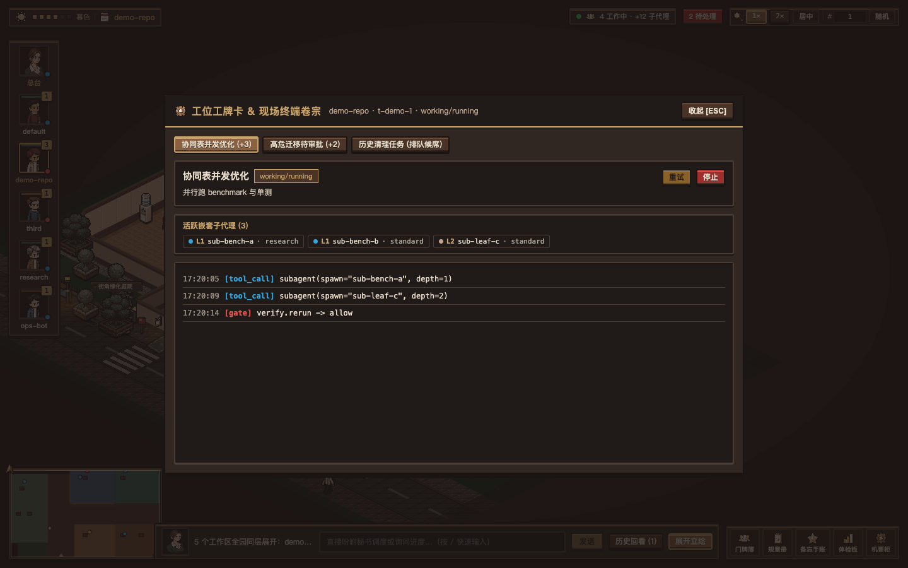
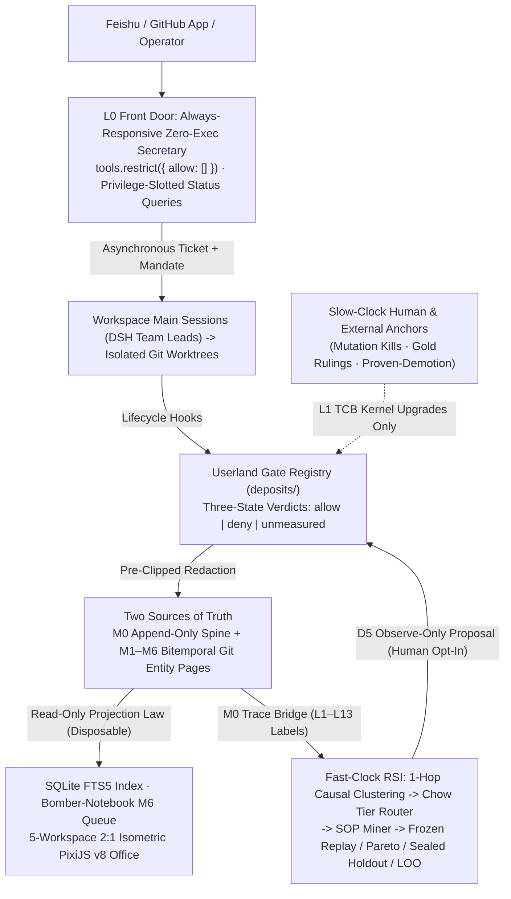

<p align="right">
  <strong>English</strong> · <a href="./README_ZH.md">简体中文</a>
</p>

# dsh-secretary

**Personal Agent Secretary, Workflow-Deposit Layer & Evaluator-First RSI Runtime built atop [DeepSeek Harness (DSH)](https://www.deepseek.com/en/harness/)** — turning one developer's scattered operational habits into versioned, empirically evaluable modules orchestrated by an always-responsive, zero-execution secretary.

> *"Orchestration is a commodity; the hard problem is firing the right judgement at the right lifecycle boundary — and making personal workflows depositable, replayable, and improvable without letting the system persuade itself."*
> — Synthesized from [`docs/design/01-ORIGIN-AND-EVOLUTION.md`](docs/design/01-ORIGIN-AND-EVOLUTION.md) & [`docs/design/NEW-REPO-BRIEF.md`](docs/design/NEW-REPO-BRIEF.md) (`246` TypeScript/TSX modules · `95` Vitest suites / `1,002` tests · `14` executable `DEPOSIT.md` packages · MIT)

<p align="center">
  
  <br />
  <sub><b>Single-plane 5-workspace PixiJS v8 cockpit:</b> read-only projection of M6 attention ledgers, synced worker portraits, isolated worktree runs &amp; nested subagent traces</sub>
</p>

<table>
  <tr>
    <td align="center" width="50%">
      
      <br />
      <sub><b>2× Close-Up:</b> deterministic game-like routines &amp; state-visible seating (zero LLM cost for actor behavior)</sub>
    </td>
    <td align="center" width="50%">
      
      <br />
      <sub><b>Worker Dossier Drawer:</b> live <code>L1/L2</code> nested subagents &amp; pre-redacted terminal traces</sub>
    </td>
  </tr>
</table>

---

## What `dsh-secretary` Actually Solves (And What It Explicitly Does Not Compete With)

`dsh-secretary` is **not** a competing coding agent or a re-implementation of agent orchestration. [DeepSeek Harness (DSH)](https://www.deepseek.com/en/harness/) already provides sessions, subagents, sandboxing, and `agent-team` execution. Maintaining bespoke orchestration logic only accumulates bloat.

Instead, `dsh-secretary` sits **one architectural layer above DSH** to answer three questions ordinary agent setups leave unsolved — starting from its flagship real-world workload: **one person + AI team maintaining live open-source repositories** (treating issue triage as *attention allocation* rather than inbox zero, enforcing 4-state bug reproduction, worktree fixes, and policy-compliant replies):

| Design Question | Prose Rules & Self-Assessed Loops (`AGENTS.md` / IDE Skills / Single-Loop RSI) | `dsh-secretary` (`Kernel + Userland Deposit + Evaluator`) |
| :--- | :--- | :--- |
| **Where personal workflows live** | Scattered prose prompts or IDE-specific skills that rely on model obedience and silently degrade under long context | **Kernel vs. Userland**: thin frozen kernel (`src/`) supplies objective sensors & primitives; personal engineering workflows live in [`deposits/`](deposits/verify-rerun/DEPOSIT.md) as **One Package, Three Readers** modules (`DEPOSIT.md` + `cases/cases.json` + read-only `LEDGER.md`) |
| **How rules enter & evolve** | Hardcoded kernel `if`-branches or unreviewed prompt tweaks that cannot be ablated | **Dual-Channel Deposit**: (a) user actively deposits personal habits (even red-green fix testing is a depositable rule, not hardcoded dogma); (b) runtime friction proposes shadow drafts (**Constitutional D5**: system proposes, human opts in, never auto-enforces) |
| **What decides if a rule helps** | Anecdotal counters (`seen >= 3`) or same-model self-judging (Goodhart reward hacking) | **Evaluator-First RSI** ([`src/rsi/`](src/rsi/index.ts)): `seen >= 3` earns *proposal rights only*; promotion requires frozen replay, zero-regression Pareto sweeps, causal 1-hop clustering, Chow tier routing, Bootstrap CI, LOO ablation & sealed Holdout |
| **How infinite self-iteration is bounded** | Recursive self-rewriting ("`Harness^k`" echo chamber) where proposer & evaluator mutate together | **Two-Clock / Three-Layer Mutability Boundary**: `L3 Userland` (deposits/params/memory) evolves on the fast clock against a frozen evaluator; `L2 Product code` changes via isolated worktree PRs reviewed by humans; `L1 TCB` (registry semantics, isolation, evaluator core) changes only on the slow clock against external anchors |
| **Why the secretary stays responsive** | Conversational agent directly runs shell/file edits, blocking the user and leaking context | **Always-Responsive Zero-Exec Secretary**: `tools.restrict({ allow: [] })` strips all execution tools (even read-only shell) ([`sessions.ts`](src/app/sessions.ts)); code inspection & fixes dispatch asynchronously to workspace main sessions (DSH Leads) in serialized git worktrees |
| **Why memory & UI stay trustworthy** | Mutable DB caches/prompts overwrite history; flashy dashboards invent fake agent states | **Believability-Driven `M0–M6` + Read-Only Projection Law**: memory serves continuity (*"feeling heard"*, zero fabrication), tracking repeat questions, false recall & corrections; SQLite FTS5 & the PixiJS v8 office are disposable read-only projections ([`reader.ts`](src/projection/reader.ts)) |

---

## System Architecture



---

## Four Core Architectural Pillars

### 1. Kernel vs. Userland: Dual-Channel `Deposit` Packages & Three-State Honesty
Rather than stuffing user workflows into `src/` (which turns a general substrate into brittle personal scripts) or leaving them as prose in `AGENTS.md` (which gets ignored without trace telemetry), every lifecycle rule enters through the **Deposit + Registry** contract ([`registry.ts`](src/judgement/registry.ts), [`pre-execute-gates.ts`](src/executor/pre-execute-gates.ts)):
- **One Package, Three Readers (`deposits/<id>/`)**: machines validate & execute frontmatter (`point`, `requires`, `params`, `verdict`); human reviewers & rubric judges read markdown intent/exceptions; evaluators run paired positive/negative + falsification fixtures in `cases/cases.json`; the system projects read-only track records to `LEDGER.md`.
- **Three-State Verdict Honesty (`allow | deny(blockers) | unmeasured`)**: missing inputs (`missing-input`), `bash`/`str_replace_editor` writes lacking structured diffs (`shell-blind`), or probe timeouts return explicit `unmeasured` — never washed into `allow`.
- **Dual-Channel Entry**: Channel (a) lets the engineer deposit habits directly (e.g., modeling R5 red-green fix verification as [`verify.rerun`](deposits/verify-rerun/DEPOSIT.md) rather than a hardcoded dogma); Channel (b) lets observed workflow friction propose shadow drafts that **never auto-enforce** without human opt-in (**Constitutional D5**).
- **Dual-Speed Risk Triage & Host-Initiated Adversarial Review**: [`workflow-risk.ts`](src/executor/workflow-risk.ts) classifies tickets into `fast` vs. `elevated` tiers. On `elevated` changes, [`adversarial-review.ts`](src/executor/adversarial-review.ts) runs host-initiated isolated LLM critiques — [`ticket.plan-review`](deposits/ticket-plan-review/DEPOSIT.md) before coding and [`verify.diff-review`](deposits/verify-diff-review/DEPOSIT.md) after deterministic gates ([`verify.command-contract`](deposits/verify-command-contract/DEPOSIT.md), [`verify.change-test-coverage`](deposits/verify-change-test-coverage/DEPOSIT.md), `verify.changed-paths`, `verify.rerun`) — strictly forbidding worker self-evaluation, dropping findings not anchored to modified files, escalating at `max_review_rounds`, and keeping `fast` tickets at zero extra LLM cost.

<details>
<summary><b>Inspect all 14 committed executable <code>DEPOSIT.md</code> packages (<code>deposits/</code>)</b></summary>

| Package ID | Kind / Stage | Workflow & Lifecycle Role | Source |
| :--- | :--- | :--- | :--- |
| `ticket.plan-review` | Gate (`observe`) | Host-initiated isolated critique on `elevated` tickets to surface counterexamples & contract risks before coding (`fast` skipped at 0 cost) | [`ticket-plan-review`](deposits/ticket-plan-review/DEPOSIT.md) |
| `verify.command-contract` | Gate (`observe`) | Rejects empty `verifyCommands`, `true`/`echo` placeholders, and `\|\| true` exit-swallowing on code changes | [`verify-command-contract`](deposits/verify-command-contract/DEPOSIT.md) |
| `verify.change-test-coverage` | Gate (`observe`) | Catches non-trivial (`>= 30` lines) feature/refactor changes landed with zero modified/added tests (`docs` exempt) | [`verify-change-test-coverage`](deposits/verify-change-test-coverage/DEPOSIT.md) |
| `verify.diff-review` | Gate (`observe`) | Host-initiated adversarial diff audit after deterministic gates pass; blocks only file-anchored `critical`/`high` findings (`max_review_rounds` escalate + revision waiver) | [`verify-diff-review`](deposits/verify-diff-review/DEPOSIT.md) |
| `verify.rerun` | Gate (`enforce`) | Anti-self-attestation: requires independent verifier rerun (`exitCode === 0`) and R5 shadow red-green evidence on `fix`/`bugfix` | [`verify-rerun`](deposits/verify-rerun/DEPOSIT.md) |
| `verify.changed-paths` | Gate (`enforce`) | Reconciles `sessionDiffs ∪ gitDirtyPaths` vs. `allowedPaths`; flags `shell-blind` rather than faking compliance | [`verify-changed-paths`](deposits/verify-changed-paths/DEPOSIT.md) |
| `verify.secret-path-guard` | Gate (`enforce`) | Zero-code `path_rules` blocking `.env*`, `secrets/**`, `*.pem/*.key`, `id_rsa*`, `.dsh/**`, and traversal | [`secret-path-guard`](deposits/secret-path-guard/DEPOSIT.md) |
| `ticket.adaptive-dispatch` | Gate (`enforce`) | Chooses `solo` vs. `team` & thinking tier from 1-hop context slice size and retry history | [`ticket-adaptive-dispatch`](deposits/ticket-adaptive-dispatch/DEPOSIT.md) |
| `verify.repro-evidence` | Gate (`observe`) | Locks reproduction into 4 terminal states; blocks closing issues on `not-reproduced` without tried matrix + human sign-off | [`repro-four-states`](deposits/repro-four-states/DEPOSIT.md) |
| `intake.bug-quadruple` | Gate (`observe`) | Audits 4-tuple bug completeness, caps dedup at T1 suggestions (`>= 0.85`), forbids premature auto-close | [`issue-intake-quadruple`](deposits/issue-intake-quadruple/DEPOSIT.md) |
| `outward.reply-desk` | Gate (`observe`) | Checks target repo AI policies (e.g., `forbid_ai_comments`), closed threads, write rate limits & human sign-off on freeform text | [`outbound-reply-desk`](deposits/outbound-reply-desk/DEPOSIT.md) |
| `friction.seen-three` | Counter (`observe`) | Enforces **D5**: `>= 3` frictions across `>= 2` workspaces creates `proposal.create`, structurally blocked from auto-enforcing | [`seen-three-friction`](deposits/seen-three-friction/DEPOSIT.md) |
| `ticket.stale-patrol` | Standing Order | Read-only cooldown-throttled reminder via `workflow_sop` checklist when working tickets stall | [`stale-ticket-patrol`](deposits/stale-ticket-patrol/DEPOSIT.md) |
| `replay.ci-evaluator` | Evaluator (`observe`) | Zero-code `predicates` evaluator enforcing holdout generalization `>= 0.75` and `0` false blocks | [`replay-ci-evaluator`](deposits/replay-ci-evaluator/DEPOSIT.md) |

</details>

### 2. Evaluator-First RSI & The Two-Clock Mutability Boundary (`src/rsi/`, `src/app/governance-ops.ts`)
Built around two core premises — **every human escalation is a system defect signal** (target KPI: interruptions shrink over time) and **frequency only proposes, evaluators decide**:
- **Trace Bridge & Natural Outcome Labels**: [`online-collector.ts`](src/rsi/online-collector.ts) + [`trace-bridge.ts`](src/rsi/trace-bridge.ts) join `M0` spine entries to DSH native session traces and backfill `L1–L13` execution outcomes + four-way escalation attribution.
- **Root-Cause & 1-Hop Code-Locus Clustering**: [`problem-clustering.ts`](src/rsi/problem-clustering.ts) + [`clustering-eval.ts`](src/rsi/clustering-eval.ts) cluster surface frictions by shared 1-hop relative-import code loci (measured with Purity, Inverse Purity, and BCubed F1) instead of brittle 1-to-1 symptom patching.
- **Chow Complexity Tier Routing & SOP Mining**: [`tier-router.ts`](src/rsi/tier-router.ts) routes work across `T0_direct_autofix` -> `T1_light_single_pass` -> `T2_heavy_causal` -> `human_spec_ruling`; [`sop-miner.ts`](src/rsi/sop-miner.ts) distills repeated ordered tool trajectories into SOP drafts.
- **Frozen Replay, Pareto Sweep & Calibration**: [`replay.ts`](src/rsi/replay.ts), [`sweep.ts`](src/rsi/sweep.ts), and [`calibration.ts`](src/rsi/calibration.ts) execute propose-only Pareto parameter searches with zero-regression guards across `train / validation / sealed holdout`, multi-seed Bootstrap CIs, leave-one-out gate ablation, and temperature/Platt calibration ([`governance-ops.ts`](src/app/governance-ops.ts)).
- **Bounding Recursive Self-Improvement (No Infinite `Harness^k` Self-Persuasion)**: Same-source LLM meta-judges collapse via self-enhancement bias and Goodhart reward hacking. The architecture therefore pins three strict mutability layers:
  - `L3 Userland` (`deposits/`, parameters, `M1–M6` memory) iterates on the **fast clock** against version-pinned evaluators;
  - `L2 Product code` (UI, channel adapters) iterates via stable parent instances (`vN`) opening PRs in isolated worktrees for `vN+1` under human merge;
  - `L1 TCB Kernel` (isolation, zero-exec enforcement, 3-state registry semantics, evaluator math) changes only on the **slow clock** under external hard anchors (mutation kills, human gold verdicts, mandatory `proven-demotion`).

### 3. Always-Responsive Zero-Exec Secretary, Worktrees & Believable `M0–M6` Memory
- **Availability Above Execution**: Even "trivial" file reads or fixes wait for a worker in an isolated git worktree rather than risking coordinator stalls or context pollution. [`sessions.ts`](src/app/sessions.ts) enforces `agent.ctx.tools.restrict({ allow: [] })`, keeping the secretary purely conversational/dispatching with non-queued structured status queries.
- **Isolated Execution & Channel Identity**: Serialized `git worktree` provisioning + Darwin CoW dependency copying stripping `.env*` & escaping symlinks ([`worktree.ts`](src/workspaces/worktree.ts)); shadow baseline R5 red-green verification ([`red-green-probe.ts`](src/executor/red-green-probe.ts)); git snapshot digest auditing ([`git-workspace-snapshot.ts`](src/executor/git-workspace-snapshot.ts)); native GitHub App JWT/proxy with DNS rebinding protection ([`github-app.ts`](src/infra/github-app.ts)) + Feishu cards ([`feishu.ts`](src/sources/feishu.ts)).
- **Believability-Driven `M0–M6` Memory ([`types.ts`](src/memory/types.ts), [`redact.ts`](src/spine/redact.ts), [`memory-brain-inspired.md`](docs/design/memory-brain-inspired.md))**: Inspired by companion & generative-agent findings — perceived continuity (*"feeling heard"*) collapses on false memories. Secrets are redacted *before* clipping (`M0`); `M1–M3` facts preserve `sourceRef` provenance and bitemporal `validFrom / supersedes / tombstone` chains (zero write side effects on read); `M4` forbids single-turn direct consolidation; `M6` throttles human interruptions via `stickyTurns` and `cooldownMs`, evaluated against repeat-question rate, false-recall count, and weekly corrections.

### 4. Read-Only Projection Law & Diegetic Pixel Office (`src/projection/`, `src/office-app/`)
Born directly from developer anxiety over *"not seeing what background subagents are doing"*, without burning extra LLM tokens to puppeteer avatars:
- **Game-Design Discipline Instead of LLM NPCs**: Draws on life-sim principles — deterministic *routines as data*, *state-visible deviation as narrative*, and *Bomber's Notebook* commitment tracking — strictly governed by the **Read-Only Projection Law** ([`reader.ts`](src/projection/reader.ts)) so deleting SQLite FTS5 or the frontend never loses domain state.
- **Single-Plane PixiJS v8 Campus**: 5 procedural workspaces ([`world-layout.ts`](src/office-app/world-layout.ts), [`roguelike-pcg.ts`](src/office-app/roguelike-pcg.ts)) enforcing 20-seed `<10%` solid-wall occlusion, 8 palette-safe worker variants synced 1:1 to sidebar portraits ([`char-variants.ts`](src/office-app/char-variants.ts)), live `L1/L2` nested subagent traces ([`worker-drawer.tsx`](src/office-app/worker-drawer.tsx)), and 5 diegetic governance drawers (`Doorplate`, D5-locked `Access Rulebook` [`prop-ledger.tsx`](src/office-app/prop-ledger.tsx), `M1–M3/M6` `Leather Notebook` [`prop-notebook.tsx`](src/office-app/prop-notebook.tsx), `RSI Corkboard` [`prop-corkboard.tsx`](src/office-app/prop-corkboard.tsx), and `Cabinet` [`prop-cabinet.tsx`](src/office-app/prop-cabinet.tsx)).

---

## Repository Map & Design Origins

| Path | Role |
| :--- | :--- |
| [`docs/design/`](docs/design/01-ORIGIN-AND-EVOLUTION.md) | Architectural origins ([`01-ORIGIN-AND-EVOLUTION.md`](docs/design/01-ORIGIN-AND-EVOLUTION.md)), [`NEW-REPO-BRIEF.md`](docs/design/NEW-REPO-BRIEF.md) & [`memory-brain-inspired.md`](docs/design/memory-brain-inspired.md) |
| [`src/judgement/`](src/judgement/registry.ts) & [`deposits/`](deposits/verify-rerun/DEPOSIT.md) | Registry contract, 3-state gate engine & `14` executable `DEPOSIT.md` packages (`cases/cases.json`) |
| [`src/rsi/`](src/rsi/index.ts) | Online `L1–L13` collector, `M0` trace bridge, 1-hop clustering, Chow router, SOP miner, Pareto sweep & calibration |
| [`src/spine/`](src/spine/store.ts) & [`src/memory/`](src/memory/types.ts) | Append-only `M0` spine (redacted pre-clip) & bitemporal `M1–M6` git-backed entity pages |
| [`src/executor/`](src/executor/pre-execute-gates.ts) & [`src/workspaces/`](src/workspaces/worktree.ts) | Pre-execute guards, risk triage, host adversarial plan/diff review ([`adversarial-review.ts`](src/executor/adversarial-review.ts)), R5 red-green probe, snapshot audit & CoW worktrees |
| [`src/app/`](src/app/sessions.ts) & [`src/infra/`](src/infra/github-app.ts) | Zero-exec secretary (`allow: []`), ruling queue, governance patrol, GitHub App & Feishu adapters |
| [`src/projection/`](src/projection/reader.ts) & [`src/office-app/`](src/office-app/stage-app.tsx) | Read-only FTS5 projection & 5-workspace 2:1 isometric PixiJS v8 cockpit |
| `tests/` | `95` Vitest suites (`1,002` tests) run against isolated temporary `DSH_HOME` |

## Isolated Verification & Development

All verification runs strictly in isolated temporary `DSH_HOME` directories without touching `~/.dsh`:

```bash
npx tsc --noEmit                                          # Strict TypeScript check
DSH_HOME=$(mktemp -d) npx vitest run                      # Full suite in isolated DSH_HOME
pnpm check                                                # Typecheck + tests + build
```

Setup instructions and engineering standards live in [SETUP.md](SETUP.md), [docs/006-deployment.md](docs/006-deployment.md), and [docs/STANDARDS.md](docs/STANDARDS.md).

## License & Attribution

[MIT](LICENSE) — built atop DeepSeek Harness's MIT-licensed `dsh-superagent` interface; the dual-channel `Deposit` layer, three-state judgement registry, bitemporal `M0–M6` spine, evaluator-first RSI suite, zero-exec secretary isolation, and PixiJS v8 pixel office are independent implementations.
