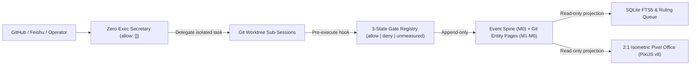

# dsh-secretary

**Governance-first autonomous coding agent harness** — append-only `M0–M6` memory spine, three-state pre-execution gates, physically zero-execution secretary orchestration, and a 2:1 isometric PixiJS v8 agent office.

> Built on the MIT-licensed [DeepSeek Harness (DSH)](https://www.deepseek.com/en/harness/) bundle interface (`dsh-superagent` origin) and substantially re-architected with an independent governance, verification, memory, and visual-telemetry stack (`224` TypeScript modules, `90` Vitest test suites).

---

## Why This Architecture

Long-running coding agents typically break down in three structural ways:
1. **Unverified self-reports** — workers claim "all tests passed" while leaving unrecorded side effects, stale baselines, or silent fallbacks.
2. **State & UI drift** — SQLite caches, dashboards, or prompts mutate independently of what actually occurred in git and tool sessions.
3. **Over-privileged coordinators** — an orchestrator session holding shell/write tools eventually bypasses isolation and executes ad-hoc mutations directly.

`dsh-secretary` enforces hard architectural boundaries against all three:



## Core Engineering Decisions

- **Two Sources of Truth & Read-Only Projection Law** (`src/spine/`, `src/memory/`, `src/projection/`)
  - Definition truth lives in a single gate registry; occurrence truth lives in append-only session logs + the `M0` event spine and git-backed `M1–M6` entity pages linked by `source_ref` sequence IDs.
  - SQLite FTS indexes, governance boards, balances, and the pixel office frontend are **strictly read-only projections** that can be deleted and deterministically rebuilt from the spine.
- **Three-State Pre-Execution Gates** (`src/judgement/`, `src/executor/pre-execute-gates.ts`, `src/executor/git-workspace-snapshot.ts`)
  - Unregistered gates do not exist. Mounted via extensible `scope.stage` points and evaluated before risky actions.
  - Every gate returns `allow | deny(blockers) | unmeasured`. Missing inputs, shell blind spots, timeouts, or parse failures **must return `unmeasured` and are never coerced to `allow`**.
  - Each gate ships with paired red/green fixtures and disable-mutation checks to prevent decorative gates.
- **Physically Zero-Execution Secretary** (`src/app/tools/`, `src/workspaces/worktree.ts`)
  - Coordinator sessions register only routing, ruling, and read-only query tools, then invoke `tools.restrict({ allow: [] })` to block all global execution tools. Code inspection and edits run strictly inside isolated git worktree sub-sessions.
- **2:1 Isometric Pixel Diorama Office** (`src/office-app/`, `src/pixel-office/`)
  - Procedural room blueprints (`room-blueprints.ts`, `roguelike-pcg.ts`), layered PixiJS v8 lighting/occlusion rendering (`pixi-diorama.ts`, `world-renderer.ts`), and a bitmap HUD projecting live agent states, rulings, and token telemetry.

## Repository Map

| Directory | Responsibility |
| :--- | :--- |
| `src/spine/` | Append-only event spine (`M0`), redaction before persistence/clipping |
| `src/memory/` | Git-backed `M1–M6` entity pages, resident budget enforcement, FTS5 read-only index |
| `src/judgement/` | Gate registry, three-state verdict engine, changed-paths & ledger verification |
| `src/executor/` | Pre-execute completion guards, git workspace snapshot & digest auditing |
| `src/app/` | Zero-exec secretary runtime, ruling queue, standing-order governance patrol |
| `src/workspaces/` | Serialized git worktree provisioning, CoW dependency copy with secret stripping |
| `src/office-app/` | PixiJS v8 2:1 isometric pixel office renderer, procedural room layouts & HUD |
| `src/rsi/` | Online friction collector & trace-to-SOP mining |
| `tests/` | `90` Vitest suites covering gates, redaction, worktrees, memory invariants & UI |
| `docs/` | Architecture docs (`000-philosophy.md` – `008-cookbook.md`, `STANDARDS.md`) |

## Verification & Development

All tests run against an isolated temporary `DSH_HOME` without touching user production state:

```bash
npx tsc --noEmit                                          # Strict TypeScript check
DSH_HOME=$(mktemp -d) npx vitest run                      # Full test suite (isolated)
pnpm check                                                # Typecheck + tests + build
```

For bundle installation and manual setup, see [SETUP.md](SETUP.md) and [docs/006-deployment.md](docs/006-deployment.md).

## License & Attribution

[MIT](LICENSE) — originally derived from DeepSeek Harness's MIT-licensed `dsh-superagent` prototype; governance, memory spine, pre-execute gate engine, and pixel office modules are independent extensions.
