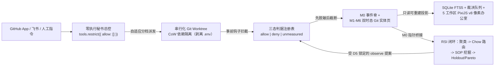

<p align="right">
  <a href="./README.md">English</a> · <strong>简体中文</strong>
</p>

# dsh-secretary

**零信任自治 Coding Agent 底座** —— 追加式 `M0–M6` 双时态记忆脊、三态事前硬闸（`allow | deny | unmeasured`）、物理零执行秘书编排、统计级 RSI 自我演进闭环，以及基于 PixiJS v8 的 2:1 等轴测像素办公室。

> 基于 MIT 协议的 [DeepSeek Harness (DSH)](https://www.deepseek.com/en/harness/) 扩展接口（`dsh-superagent` 原型）深度重构，独立建设三态治理判局、证据记忆脊、隔离执行与可视化遥测体系（`238` 个 TypeScript/TSX 模块 · `94` 套 Vitest 测试集 / `505` 条用例 · `10` 个可执行 Deposit 规则包 · MIT）。

<p align="center">
  
  <br />
  <sub><b>5 工作区同层展开 PixiJS v8 园区：</b>左侧导览栏 1:1 匹配员工头像、实时裁决队列、Worktree 隔离会话与嵌套子代理聚合遥测</sub>
</p>

<table>
  <tr>
    <td align="center" width="50%">
      
      <br />
      <sub><b>2× 近景细节：</b>协作桌双人落座、6 格宽走廊、8 款 46 色衍生员工与 <code>+N</code> 嵌套子代理角标</sub>
    </td>
    <td align="center" width="50%">
      
      <br />
      <sub><b>工位卷宗抽屉：</b>实时 <code>L1/L2</code> 嵌套子代理层级与先脱敏后截断现场终端轨迹</sub>
    </td>
  </tr>
</table>

---

## 主流 Coding Agent vs. `dsh-secretary`

长周期自治编程代理一旦把约束只写在 Prompt 里，就会在工程中反复踩中同一批结构性失效；`dsh-secretary` 用可验证的机械门禁与存储契约逐一堵死漏洞：

| 结构性痛点 | 主流 Agent 常见表现 | `dsh-secretary` 机械化保障 |
| :--- | :--- | :--- |
| **自报完成失真** | 子代理改删断言、跳过测试或留下一堆未追踪脏文件，却回报“测试全通过” | 独立验收重跑 [`verify.rerun`](deposits/verify-rerun/DEPOSIT.md) + 隔离影子 R5 撤修复红绿探针（[`red-green-probe.ts`](src/executor/red-green-probe.ts)）+ Git 快照摘要核验（[`git-workspace-snapshot.ts`](src/executor/git-workspace-snapshot.ts)） |
| **软门禁与静默洗白** | Prompt 约束容易被上下文稀释；遇缺失字段、超时或 Shell 盲区时默认放行 | 唯一注册表挂载 **三态事前硬闸**（`allow \| deny(blockers) \| unmeasured`）；Blind spot 与缺证据严禁洗白为 `allow`（[`registry.ts`](src/judgement/registry.ts)、[`pre-execute-gates.ts`](src/executor/pre-execute-gates.ts)） |
| **总控会话越权** | 持有读写与 Shell 权限的编排器最终绕开隔离，直接顺手改仓库代码 | 秘书总控仅装配路由/裁决/只读工具，随后调用 `tools.restrict({ allow: [] })` 物理锁死执行权限（[`sessions.ts`](src/app/sessions.ts)），读写仅在独立 Git Worktree 子会话完成（[`worktree.ts`](src/workspaces/worktree.ts)） |
| **状态漂移与假记忆** | 数据库缓存与摘要随对话悄悄改写历史，脱离 Git 与真实事件流 | **两类不可动摇真相源**：追加式 `M0` 事件脊（[`store.ts`](src/spine/store.ts)）+ Git 双时态实体页 `M1–M6`（[`types.ts`](src/memory/types.ts)）；SQLite FTS5 与前端一律为可删可重建的只读投影（[`reader.ts`](src/projection/reader.ts)） |
| **凭感觉微调 Prompt** | 靠零星个案手工改提示词，缺少留出集回归验证与冲突消融 | **统计级 RSI 自我演进闭环**（[`src/rsi/`](src/rsi/index.ts)）：在线摩擦聚类、Chow 分层复杂度路由、Trace-to-SOP 提炼、Pareto 寻优与 Bootstrap/Holdout/消融校准 |
| **不可观测的黑盒终端** | 多工作区状态淹没在滚屏日志或脱离真实状态的展示页 | **5 工作区 2:1 等轴测 PixiJS v8 作战驾驶舱**：5 大拟物治理抽屉直连真实账本，实时透视 `L1/L2` 嵌套子代理链路（[`stage-app.tsx`](src/office-app/stage-app.tsx)） |

---

## 系统架构图



---

## 五大核心工程支柱

### 1. 零信任三态判局与 10 套可执行 Deposit 规则包
判据不进注册表即不存在，统一挂载至可扩展 `scope.stage` 节点并在高风险工具调用、对外发声或声明完工前判定（[`registry.ts`](src/judgement/registry.ts)、[`pre-execute-gates.ts`](src/executor/pre-execute-gates.ts)）。系统严格执行 **三态诚实**：遇到无结构化 Diff 记录的 `bash` / `str_replace_editor` 写操作即返回 `unmeasured(shell-blind)`，缺关键输入字段即返回 `unmeasured(missing-input)`。每套 Deposit 规则包都配套红/绿双向回归夹具（`cases/cases.json`）与禁用变异测试，彻底杜绝“装饰性门禁”。

<details>
<summary><b>展开查看仓库内置全部 10 套可执行 Deposit 规则包（<code>deposits/</code>）</b></summary>

| 规则包 ID | 类型 / 阶段 | 拦截目标与核心机制 | 源码入口 |
| :--- | :--- | :--- | :--- |
| `verify.rerun` | 硬闸（`enforce`） | 禁绝自报自验：要求独立验证方重跑通过（`exitCode === 0`），`fix/bugfix` 任务强迫提供 R5 撤修复必红证据 | [`verify-rerun`](deposits/verify-rerun/DEPOSIT.md) |
| `verify.changed-paths` | 硬闸（`enforce`） | 核对 `sessionDiffs ∪ gitDirtyPaths` 与 `allowedPaths` 边界；遇无 Diff 写入诚实标 `shell-blind` | [`verify-changed-paths`](deposits/verify-changed-paths/DEPOSIT.md) |
| `verify.secret-path-guard` | 硬闸（`enforce`） | 零代码 `path_rules` 拦截 `.env*`、`secrets/**`、`*.pem/*.key`、`id_rsa*`、`.dsh/**` 与路径越界 | [`secret-path-guard`](deposits/secret-path-guard/DEPOSIT.md) |
| `ticket.adaptive-dispatch` | 硬闸（`enforce`） | 按 1-Hop 代码切片文件数、字节数与连续失败次数自适应切换 `solo / team` 与思考档位 | [`ticket-adaptive-dispatch`](deposits/ticket-adaptive-dispatch/DEPOSIT.md) |
| `verify.repro-evidence` | 观测闸（`observe`） | 将 Bug 复现收口为 4 类合法终态，禁止未确认 `not-reproduced` 在无环境矩阵与人批时擅自关单 | [`repro-four-states`](deposits/repro-four-states/DEPOSIT.md) |
| `intake.bug-quadruple` | 观测闸（`observe`） | 校验 Bug 四元组（版本/平台/步骤/报错原文），去重严格封顶 T1 候选表（`>= 0.85`），禁止自动关重 | [`issue-intake-quadruple`](deposits/issue-intake-quadruple/DEPOSIT.md) |
| `outward.reply-desk` | 观测闸（`observe`） | 核验目标仓 AI 政策（如 `forbid_ai_comments`）、已关闭线程拦截、写限额熔断与自由文本人批锁 | [`outbound-reply-desk`](deposits/outbound-reply-desk/DEPOSIT.md) |
| `friction.seen-three` | 计数规则（`observe`） | 恪守宪法 **D5 非阻塞提案权**：跨 `>= 2` 工作区累计同类摩擦 `>= 3` 次才提 `proposal.create`，永不自升硬闸 | [`seen-three-friction`](deposits/seen-three-friction/DEPOSIT.md) |
| `ticket.stale-patrol` | 常驻巡检 | 基于零代码 `workflow_sop` 清单与冷却窗口，仅对超时仍开放工单发送温和 `ticket.remind` | [`stale-ticket-patrol`](deposits/stale-ticket-patrol/DEPOSIT.md) |
| `replay.ci-evaluator` | 评估器（`observe`） | 在冻结 Holdout 数据集校验候选规则，要求泛化比 `>= 0.75` 且历史零误拦（`falseBlocks <= 0`） | [`replay-ci-evaluator`](deposits/replay-ci-evaluator/DEPOSIT.md) |

</details>

### 2. 仿人脑双时态记忆脊（`M0–M6`）与只读投影律
记忆系统拒绝“靠 Prompt 覆写历史”，严格拆分发生真相与派生索引（[`src/memory/types.ts`](src/memory/types.ts)、[`src/spine/redact.ts`](src/spine/redact.ts)）：
- **先脱敏后截断（`M0` 事件脊）**：[`redact.ts`](src/spine/redact.ts) 在一切截断或落盘之前清洗私钥、API Token、飞书 Webhook 与 URL 凭据，避免切片边界泄漏半截密钥。
- **可溯源双时态事实层（`M1–M3`）**：每条记忆携带指向 `M0` 序号的 `sourceRef`、`validFrom / validTo / supersedes` 版本链（改口新增版本从不篡改历史）、`taint` 污点标记（`clean | external_untrusted`）及密级隔离。
- **跨层隔离与防骚扰预算（`M4–M6`）**：`M4` 慢抽象巩固禁止单轮会话直接写入；`M5` 规则晋升必须附正反例验证；`M6` 待裁账本自带 `stickyTurns` 与 `cooldownMs` 节流防重复追问；**读取绝不产生写副作用**。
- **可删可重建只读投影**：SQLite FTS5 全文索引、额度账本、裁决队列与像素办公室前端均可随时删除并用事件脊确定性重放重建（[`reader.ts`](src/projection/reader.ts)）。

### 3. 统计级 RSI 自我演进闭环（`src/rsi/`）
将运行时摩擦转化为可评估、可回放、受人裁保护的规则提案（绝不静默自改生产配置）：
- **在线采集与指针桥接**：[`online-collector.ts`](src/rsi/online-collector.ts) 与 [`trace-bridge.ts`](src/rsi/trace-bridge.ts) 回填 `L1–L13` 天然结果标签，并将 `M0` 事件关联至 DSH 原生会话轨迹。
- **因果链 + 1-Hop 导入图聚类**：[`problem-clustering.ts`](src/rsi/problem-clustering.ts) 与 [`clustering-eval.ts`](src/rsi/clustering-eval.ts) 按相对导入图焦点交集做根因聚类，并用 Purity / Inverse Purity / BCubed F1 量化纯度。
- **Chow 最优分层路由与 SOP 挖掘**：[`tier-router.ts`](src/rsi/tier-router.ts) 依据聚类特征在 `T0_direct_autofix` -> `T1_light_single_pass` -> `T2_heavy_causal` -> `human_spec_ruling` 间分级派发；[`sop-miner.ts`](src/rsi/sop-miner.ts) 从有序工具链半自动提炼 SOP 草案。
- **冻结回放、Pareto 寻优与统计校准**：[`replay.ts`](src/rsi/replay.ts)、[`sweep.ts`](src/rsi/sweep.ts) 与 [`calibration.ts`](src/rsi/calibration.ts) 覆盖零退化边界约束下的 Pareto 参数寻优、多种子 Bootstrap 置信区间、密封 Holdout 开封门、全注册表留一消融与 Platt 校准。

### 4. 物理零执行编排、Worktree 隔离与原生通道身份
- **物理剥权秘书**：[`sessions.ts`](src/app/sessions.ts) 在总控会话完成专用路由工具注册后调用 `agent.ctx.tools.restrict({ allow: [] })`，从宿主内核层面消除越权改代码可能。
- **Worktree 串行化与秘密剥离**：[`worktree.ts`](src/workspaces/worktree.ts) 串行化 `git worktree` 创建规避 `.git/config` 并发锁冲突，Darwin 写时复制依赖隔离自动剥离 `.env*`、`.envrc`、`.dsh` 与逃逸软链。
- **原生 GitHub App 身份与飞书协同**：[`github-app.ts`](src/infra/github-app.ts) 实现零外部依赖 JWT / 安装令牌缓存、Manifest 一键向导、`gh-app` 代理（含严格 `git-credential` Host 校验、DNS Rebinding 防护与 fail-closed 仓库探针）；[`feishu.ts`](src/sources/feishu.ts) 承接飞书事件与交互卡片。

### 5. 5 工作区 2:1 等轴测像素办公室（`src/office-app/`）
拒绝假数据大屏，把真实运行时状态直接投影为交互式 PixiJS v8 立体校园：
- **跨种子几何不变量**：[`world-layout.ts`](src/office-app/world-layout.ts) 与 [`roguelike-pcg.ts`](src/office-app/roguelike-pcg.ts) 在同层生成 5 工作区校园，守护 20 个随机种子下机要柜/工位/通道实心墙遮挡率 `<10%`。
- **头像 1:1 同步与实时嵌套排障**：[`char-variants.ts`](src/office-app/char-variants.ts) 为 8 款 46 色员工外观与左侧栏导览头像建立严格映射；[`worker-drawer.tsx`](src/office-app/worker-drawer.tsx) 直接透视工位活跃的 `L1/L2` 嵌套子代理树与脱敏终端轨迹。
- **五大拟物治理抽屉**：《工作区门牌簿》、自带 D5 禁升锁定的羊皮纸《门禁规章册》（[`prop-ledger.tsx`](src/office-app/prop-ledger.tsx)）、仅写 M1–M3 与 M6 待办的《皮质备忘手账》（[`prop-notebook.tsx`](src/office-app/prop-notebook.tsx)）、《软木体检板》（[`prop-corkboard.tsx`](src/office-app/prop-corkboard.tsx)）与《机要文件柜》（[`prop-cabinet.tsx`](src/office-app/prop-cabinet.tsx)）。

---

## 目录结构速览

| 目录 | 核心职责 |
| :--- | :--- |
| [`src/spine/`](src/spine/store.ts) | 追加式 `M0` 事件脊与截断前密钥脱敏 |
| [`src/memory/`](src/memory/types.ts) | Git 托管 `M1–M6` 双时态实体页、常驻预算控制与只读 FTS5 索引 |
| [`src/judgement/`](src/judgement/registry.ts) | 判据注册表、三态裁决引擎、变更路径与账本一致性核验 |
| [`src/executor/`](src/executor/pre-execute-gates.ts) | 事前完成守卫、R5 影子基线红绿探针与 Git 快照摘要审计 |
| [`src/app/`](src/app/sessions.ts) | 零执行秘书运行时、裁决队列与常驻治理巡检 |
| [`src/workspaces/`](src/workspaces/worktree.ts) | 串行化 Git Worktree 调度、写时复制依赖隔离与秘密文件剥离 |
| [`src/rsi/`](src/rsi/index.ts) | 在线摩擦采集、1-Hop 聚类、Chow 路由、SOP 挖掘、Pareto 寻优与统计校准 |
| [`src/infra/`](src/infra/github-app.ts) & [`src/sources/`](src/sources/feishu.ts) | 原生 GitHub App JWT/代理运行时、Webhook 触发器与飞书卡片通道 |
| [`src/office-app/`](src/office-app/stage-app.tsx) | PixiJS v8 2:1 等轴测 5 工作区像素办公室、位图 HUD 与治理抽屉 |
| `deposits/` & `tests/` | `10` 套可执行 Deposit 规则包（`cases.json`）与 `94` 套 Vitest 测试（`505` 用例） |

## 隔离验证与开发

所有测试均在独立临时 `DSH_HOME` 下执行，严禁读写本机 `~/.dsh` 生产目录：

```bash
npx tsc --noEmit                                          # 严格 TypeScript 类型检查
DSH_HOME=$(mktemp -d) npx vitest run                      # 全量测试（隔离环境）
pnpm check                                                # 类型检查 + 测试 + 构建
```

安装向导与部署约束见 [SETUP.md](SETUP.md)、[docs/006-deployment.md](docs/006-deployment.md) 与 [docs/STANDARDS.md](docs/STANDARDS.md)。

## 开源协议与致谢

[MIT](LICENSE) —— 上游衍生自 DeepSeek Harness 的 MIT 开源原型 `dsh-superagent`；三态治理判局、`M0–M6` 双时态记忆脊、隔离执行与红绿核验底座、RSI 闭环与 PixiJS v8 像素办公室为独立自研实现。
