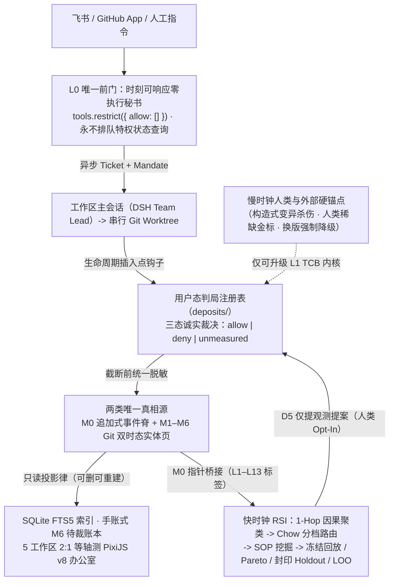

<p align="right">
  <a href="./README.md">English</a> · <strong>简体中文</strong>
</p>

# dsh-secretary

**构建在 [DeepSeek Harness (DSH)](https://www.deepseek.com/en/harness/) 之上的个人秘书、工作流沉淀层与评估器驱动 RSI 底座** —— 将开发者个人的工程习惯与风控经验沉淀为“可插拔、可回放、可消融、可评测”的标准化模块，由物理零执行、时刻在线的个人秘书统一调度。

> **“编排本身已经成了基础设施，真正难的是在生命周期的正确时刻做出正确判断 —— 并让个人工作流既能被任何人轻易沉淀进来，又能经由独立评估器用收敛收益证明自己配不配留下，而不是靠系统自己说服自己。”**
> —— 核心脉络见 [项目缘起与演变](docs/design/01-ORIGIN-AND-EVOLUTION.md) 与 [新仓架构简报](docs/design/NEW-REPO-BRIEF.md)（`238` 个 TS/TSX 模块 · `94` 套 Vitest 测试集 / `505` 用例 · `10` 套可执行 `DEPOSIT.md` 沉淀包 · MIT）

<p align="center">
  
  <br />
  <sub><b>5 工作区单平面 PixiJS v8 驾驶舱：</b>M6 注意力账本、1:1 匹配员工头像、Git Worktree 子会话与嵌套子代理轨迹的严格只读投影</sub>
</p>

<table>
  <tr>
    <td align="center" width="50%">
      
      <br />
      <sub><b>2× 近景细节：</b>借用生活模拟游戏的“例程即数据 + 状态可见”确定性投影（小人行为零 LLM 消耗）</sub>
    </td>
    <td align="center" width="50%">
      
      <br />
      <sub><b>工位卷宗抽屉：</b>实时透视 <code>L1/L2</code> 嵌套子代理层级与先脱敏后截断现场终端轨迹</sub>
    </td>
  </tr>
</table>

---

## 本项目解决什么问题（以及刻意不与谁竞争）

`dsh-secretary` **从不打算去造另一个 Coding Agent**，也不重写底层编排引擎。DeepSeek Harness（DSH）官方本体已经把会话持久流、子代理、权限沙箱与 `agent-team` 做好了；自己再维护一套重复编排层只会带来纯粹的维护税。

`dsh-secretary` 站高一层，回答普通 Agent 工作流在长期真实使用中始终没解决的 **个人系统化难题** —— 并锁定第一个真刀真枪的旗舰场景：**一个人 + AI 团队真实维护开源仓库**（把 Issue 分诊建模为“稀缺注意力分配”而非清零队列、四终态 Bug 复现、Worktree 隔离修复、受策略约束的对外回复以及 `vN` 托管 `vN+1` 吃狗粮）：

| 核心命题 | 传统散文规则 & 自产自评闭环（`AGENTS.md` / IDE Skill / 单环自改写） | `dsh-secretary` 方案（`Kernel + Deposit + Evaluator`） |
| :--- | :--- | :--- |
| **个人工作流放哪里** | 写进长篇 Prompt 或绑定特定 IDE 的 Skill，全凭模型自觉遵守，上下文一长就滑坡 | **内核态 vs. 用户态切分**：薄底座（`src/`）只放客观传感器与机械原语；个人流程放进 [`deposits/`](deposits/verify-rerun/DEPOSIT.md)，严格贯彻 **一包三读者**（机器读清单、人与裁判读意图/例外、评估器读 `cases.json` + 只读 `LEDGER.md`） |
| **规则如何进入并演进** | 硬编码写死进 `src/`（变成个人脚手架），或靠零散口头纠正每次从头教 | **双通道沉淀**：(a) 人把成熟工作流主动沉淀进来（连“修 Bug 必带撤修复变红测试”也是可沉淀模块而非死规矩）；(b) 从真实摩擦长出影子草案（**宪法 D5**：系统提议、人定安装，永不自动升 `enforce`） |
| **凭什么判断一条规则有效** | 凭“出现三次”（`Seen >= 3`）的轶事计数，或让同源大模型自己打分（极易触发 Goodhart 奖励黑客） | **评估器是一等公民**（[`src/rsi/`](src/rsi/index.ts)）：`Seen >= 3` 仅授予 Rung 1 提案权；能否转正必须过版本钉死的评估器（因果 1-Hop 聚类、Chow 路由、冻结回放、Pareto 零退化寻优、多种子 Bootstrap CI、封印 Holdout 与留一消融） |
| **如何避免无限自迭代失控** | “`Harness^k`”式同源单环自改写（执行者、提议者与裁判互相迁就退化成回声室） | **双时钟 / 三层可变性边界**：`L3 用户态`（沉淀包/参数/记忆）随冻结评估器快时钟演化；`L2 业务应用码` 由稳定父实例 `vN` 在 Worktree 提 PR 经人合并升 `vN+1`；`L1 可信计算基 TCB` 只在外部硬锚点驱动下慢时钟升级 |
| **为什么秘书能做到时刻可响应** | 对话主会话亲自下场跑 Shell 或改代码，一旦长耗时执行，入口立刻卡死且污染上下文 | **响应性第一的零执行秘书**：注册专属路由/只读特权查询槽后调 `tools.restrict({ allow: [] })` 物理锁死执行工具（[`sessions.ts`](src/app/sessions.ts)），哪怕简单查代码也异步派给隔离 Worktree 下的工作区主会话（DSH Lead） |
| **为什么记忆与界面能保真** | 靠覆盖式摘要强改历史，或用大模型驱动花哨前端“演活人”却与实情脱节 | **真实感驱动的 `M0–M6` + 只读投影律**：记忆核心指标是“被听见感”（零假回忆、降重复提问）；SQLite FTS5 与 PixiJS v8 像素办公室全部是可随时删掉重建的只读投影（[`reader.ts`](src/projection/reader.ts)） |

---

## 系统架构图



---

## 四大核心架构支柱

### 1. 内核态 vs. 用户态：双通道 `Deposit` 机制（一包三读者）与三态诚实
为了彻底防止“工作流一多内核就臃肿”，同时避免 `AGENTS.md` 类散文规则无法被程序校验与评测，系统在 DSH 之上构建了以 [`registry.ts`](src/judgement/registry.ts) 与 [`pre-execute-gates.ts`](src/executor/pre-execute-gates.ts) 为核心的沉淀注册体系：
- **一包三读者（`deposits/<id>/`）**：机器解析 frontmatter（`point` / `requires` / `params` / `verdict`）；人类与语义裁判读 Markdown 正文中的立法意图与例外；评估器跑 `cases/cases.json` 中的正反例与构造证伪对；系统侧向 `LEDGER.md` 单向投影只读战绩。
- **三态诚实红线（`allow | deny(blockers) | unmeasured`）**：面对缺乏结构化 Diff 记录的 `bash` / `str_replace_editor` 写操作（`shell-blind`）、缺必填输入字段（`missing-input`）或超时，门禁必须老实吐出 `unmeasured`，**严禁静默洗白为 `allow`**。
- **双通道沉淀**：通道 (a) 由开发者主动把个人工程习惯（如把“修缺陷必附 R5 撤修复必红测试”封装为 [`verify.rerun`](deposits/verify-rerun/DEPOSIT.md)）沉淀进注册表；通道 (b) 由真实摩擦孵化影子提案，恪守 **宪法 D5**，永不未经人批自行升级为强阻断。

<details>
<summary><b>展开查看已沉淀的全部 10 套可执行 <code>DEPOSIT.md</code> 包（<code>deposits/</code>）</b></summary>

| 规则包 ID | 形态 / 阶段 | 承载的工程工作流与核心判据 | 源码入口 |
| :--- | :--- | :--- | :--- |
| `verify.rerun` | 硬闸（`enforce`） | 反自报完成：强制独立验证方重跑通过（`exitCode === 0`），`fix/bugfix` 工单必须附带 R5 影子基线撤修复必红证据 | [`verify-rerun`](deposits/verify-rerun/DEPOSIT.md) |
| `verify.changed-paths` | 硬闸（`enforce`） | 核对 `sessionDiffs ∪ gitDirtyPaths` 与 `allowedPaths` 边界；遇无 Diff 写入诚实返回 `shell-blind` | [`verify-changed-paths`](deposits/verify-changed-paths/DEPOSIT.md) |
| `verify.secret-path-guard` | 硬闸（`enforce`） | 零代码 `path_rules` 封锁 `.env*`、`secrets/**`、`*.pem/*.key`、`id_rsa*`、`.dsh/**` 及路径穿越 | [`secret-path-guard`](deposits/secret-path-guard/DEPOSIT.md) |
| `ticket.adaptive-dispatch` | 硬闸（`enforce`） | 按 1-Hop 上下文切片文件数、字节数与连续失败次数自适应分配 `solo / team` 与思考档位 | [`ticket-adaptive-dispatch`](deposits/ticket-adaptive-dispatch/DEPOSIT.md) |
| `verify.repro-evidence` | 观测闸（`observe`） | 收口开源 Bug 复现四合法终态；禁止未附环境矩阵与人批时凭 `not-reproduced` 擅自关单 | [`repro-four-states`](deposits/repro-four-states/DEPOSIT.md) |
| `intake.bug-quadruple` | 观测闸（`observe`） | 校验 Bug 四元组（版本/平台/步骤/报错原文），去重严格封顶 T1 建议表（`>= 0.85`），禁止自动关重 | [`issue-intake-quadruple`](deposits/issue-intake-quadruple/DEPOSIT.md) |
| `outward.reply-desk` | 观测闸（`observe`） | 核验目标仓 AI 政策（如 `forbid_ai_comments`）、已关闭线程拦截、写限额熔断与自由文本人批锁 | [`outbound-reply-desk`](deposits/outbound-reply-desk/DEPOSIT.md) |
| `friction.seen-three` | 计数规则（`observe`） | 落实 **D5 提案天花板**：跨 `>= 2` 工作区累计同类摩擦 `>= 3` 次只产 `proposal.create`，机构级禁止升硬闸 | [`seen-three-friction`](deposits/seen-three-friction/DEPOSIT.md) |
| `ticket.stale-patrol` | 常驻巡检 | 基于 `workflow_sop` 清单与冷却窗口，仅对静默且仍开放工单发送温和 `ticket.remind` | [`stale-ticket-patrol`](deposits/stale-ticket-patrol/DEPOSIT.md) |
| `replay.ci-evaluator` | 评估器（`observe`） | 零代码 `predicates` 评估器：强卡 Holdout 泛化比 `>= 0.75` 与零误拦（`falseBlocks <= 0`） | [`replay-ci-evaluator`](deposits/replay-ci-evaluator/DEPOSIT.md) |

</details>

### 2. 评估器优先的 RSI 体系与双时钟可变性边界（`src/rsi/`、`src/app/governance-ops.ts`）
系统建立在两条铁律之上：**每一次上报（Escalation）都是现有判据的缺陷信号**（长期目标函数是让人类被打扰频率随使用单调下降），以及 **频率只配提议、评估器才配裁决**：
- **事件脊指针桥与天然标签**：[`online-collector.ts`](src/rsi/online-collector.ts) 与 [`trace-bridge.ts`](src/rsi/trace-bridge.ts) 将 `M0` 脊账本关联至 DSH 原生会话轨迹，回填 `L1–L13` 天然执行结果标签及四分归因。
- **因果链 + 1-Hop 导入图根因聚类**：[`problem-clustering.ts`](src/rsi/problem-clustering.ts) 与 [`clustering-eval.ts`](src/rsi/clustering-eval.ts) 按相对导入图共享焦点聚合表象摩擦（配套 Purity / Inverse Purity / BCubed F1 评测），反对见一个报错打一个局部补丁。
- **Chow 最优分层路由与 SOP 挖掘**：[`tier-router.ts`](src/rsi/tier-router.ts) 依据集群复杂特征在 `T0_direct_autofix` -> `T1_light_single_pass` -> `T2_heavy_causal` -> `human_spec_ruling` 间做经济性路由；[`sop-miner.ts`](src/rsi/sop-miner.ts) 从有序工具轨迹半自动提炼 SOP 草案。
- **冻结回放、零退化 Pareto 寻优与统计校准**：[`replay.ts`](src/rsi/replay.ts)、[`sweep.ts`](src/rsi/sweep.ts) 与 [`calibration.ts`](src/rsi/calibration.ts) 在切分隔离的 `train / validation / sealed holdout` 上执行只提案不改配置的 Pareto 寻优、多种子 Bootstrap 置信区间、留一消融（LOO）及温度/Platt 校准（[`governance-ops.ts`](src/app/governance-ops.ts)）。
- **防无限套娃与奖励黑客的边界设计**：同源大模型互相评审无法突破信息论上限（只会把自增强偏置做成回声室）。因此体系严格划分 **三层可变性与双时钟节奏**：
  - `L3 用户开放层`（`deposits/`、参数、记忆）在冻结评估器下按 **快时钟** 演化；
  - `L2 业务应用码`（像素前端、通道适配）可由稳定父实例 `vN` 在 Worktree 修后提 PR、经人审核合入升级为 `vN+1`；
  - `L1 可信计算基 TCB`（隔离、零执行封锁、三态注册表语义、评估器算法本身）只在外部硬锚点（构造式变异杀伤、人类稀缺金标裁决、评估器升级触发全量降级复测 `proven-demotion`）下按 **慢时钟** 升级。

### 3. 时刻可响应的零执行秘书、隔离执行与“真实感”记忆（`M0–M6`）
- **响应性优先于亲自干活**：哪怕一行代码的查错也禁止阻塞总控前门。[`sessions.ts`](src/app/sessions.ts) 注册专用路由与特权状态查询槽后调 `agent.ctx.tools.restrict({ allow: [] })`，物理切断所有执行工具（包括只读 Shell），一切实操均异步派给挂载隔离 Git Worktree 的工作区主会话（DSH Lead）。
- **隔离执行与原生通道身份**：串行化 Worktree 创建与 Darwin 写时复制剥离 `.env*`/逃逸软链（[`worktree.ts`](src/workspaces/worktree.ts)）；R5 影子基线撤修复红绿探针（[`red-green-probe.ts`](src/executor/red-green-probe.ts)）+ Git 工作区摘要防篡改审计（[`git-workspace-snapshot.ts`](src/executor/git-workspace-snapshot.ts)）；原生 GitHub App JWT/代理附严格 `git-credential` Host 校验与 DNS Rebinding 防护（[`github-app.ts`](src/infra/github-app.ts)），配合飞书交互卡片（[`feishu.ts`](src/sources/feishu.ts)）。
- **由真实感（Believability）而非单纯 RAG 驱动的 `M0–M6` 记忆**（[`types.ts`](src/memory/types.ts)、[`redact.ts`](src/spine/redact.ts)、[`memory-brain-inspired.md`](docs/design/memory-brain-inspired.md)）：对单用户长期关系而言，**假回忆比没记忆更致命**，真实感来自“被听见感”（记得准、少重复问、不编造）。系统规定 **先脱敏后截断**（`M0`）、带 `sourceRef` 与 `validFrom / supersedes / tombstone` 的版本链（读取绝不改写历史）、`M4` 禁止单轮直写、`M6` 自带 `stickyTurns / cooldownMs` 防追问扰民，并以 **重复提问率、假回忆事件数、周被纠正条数** 纳入长期台账。

### 4. 只读投影律与反黑盒像素办公室（`src/projection/`、`src/office-app/`）
前端像素办公室并非脱离实际的装饰品，它直接回应“后台十几个子代理究竟卡在哪”的观测焦虑，同时拒绝花高昂 Token 去让 LLM 驱动小人聊天：
- **借用生活模拟游戏哲学 + 严格只读投影**：吸收经典模拟游戏“**例程即数据、偏差才产生叙事、用《魔力面具》Notebook 形态展示 M6 待办账本**”的低成本设计，小人位置与状态全部由真实运行状态确定性映射，SQLite FTS5 与前端界面统统属于可删可重建的只读投影（[`reader.ts`](src/projection/reader.ts)）。
- **5 工作区单平面 PixiJS v8 园区**：[`world-layout.ts`](src/office-app/world-layout.ts) 与 [`roguelike-pcg.ts`](src/office-app/roguelike-pcg.ts) 保障 20 个随机种子下机要柜与通道遮挡率 `<10%`；[`char-variants.ts`](src/office-app/char-variants.ts) 为 8 款 46 色员工外观与侧栏头像建立 1:1 同步；[`worker-drawer.tsx`](src/office-app/worker-drawer.tsx) 实时展开 `L1/L2` 嵌套子代理树与脱敏现场终端；5 大拟物抽屉（《门牌簿》、自带 D5 禁升锁的《规章册》[`prop-ledger.tsx`](src/office-app/prop-ledger.tsx)、只写 M1–M3/M6 的《备忘手账》[`prop-notebook.tsx`](src/office-app/prop-notebook.tsx)、《软木体检板》[`prop-corkboard.tsx`](src/office-app/prop-corkboard.tsx) 与《机要文件柜》[`prop-cabinet.tsx`](src/office-app/prop-cabinet.tsx)）直连真实账本。

---

## 目录结构与设计起源

| 目录 | 核心职责 |
| :--- | :--- |
| [`docs/design/`](docs/design/01-ORIGIN-AND-EVOLUTION.md) | 设计源起与转折实录（[`01-ORIGIN-AND-EVOLUTION.md`](docs/design/01-ORIGIN-AND-EVOLUTION.md)、[`NEW-REPO-BRIEF.md`](docs/design/NEW-REPO-BRIEF.md)、[`memory-brain-inspired.md`](docs/design/memory-brain-inspired.md)） |
| [`src/judgement/`](src/judgement/registry.ts) & [`deposits/`](deposits/verify-rerun/DEPOSIT.md) | 判局注册表契约、三态判定核与 `10` 套可执行 `DEPOSIT.md` 沉淀包 |
| [`src/rsi/`](src/rsi/index.ts) | `L1–L13` 在线采集、`M0` 指针桥、1-Hop 聚类、Chow 路由、SOP 挖掘、Pareto 寻优与统计校准 |
| [`src/spine/`](src/spine/store.ts) & [`src/memory/`](src/memory/types.ts) | 追加式 `M0` 事件脊（截断前脱敏）与 Git 托管 `M1–M6` 双时态记忆页 |
| [`src/executor/`](src/executor/pre-execute-gates.ts) & [`src/workspaces/`](src/workspaces/worktree.ts) | 事前硬闸、R5 影子基线红绿探针、快照摘要核验与串行 CoW Worktree |
| [`src/app/`](src/app/sessions.ts) & [`src/infra/`](src/infra/github-app.ts) | 零执行秘书（`allow: []`）、待裁队列、巡检闭环、GitHub App 与飞书通道 |
| [`src/projection/`](src/projection/reader.ts) & [`src/office-app/`](src/office-app/stage-app.tsx) | 只读 FTS5 投影与 5 工作区 2:1 等轴测 PixiJS v8 驾驶舱 |
| `tests/` | `94` 套 Vitest 测试（`505` 用例），全部在独立临时 `DSH_HOME` 下隔离验证 |

## 隔离验证与开发

所有测试严格运行在临时隔离的 `DSH_HOME` 中，绝不触碰本机 `~/.dsh` 生产目录：

```bash
npx tsc --noEmit                                          # 严格 TypeScript 类型检查
DSH_HOME=$(mktemp -d) npx vitest run                      # 隔离环境全量测试
pnpm check                                                # 类型检查 + 测试 + 构建
```

安装部署细节与规范约束见 [SETUP.md](SETUP.md)、[docs/006-deployment.md](docs/006-deployment.md) 与 [docs/STANDARDS.md](docs/STANDARDS.md)。

## 开源协议与致谢

[MIT](LICENSE) —— 基于 DeepSeek Harness 的 MIT 开源原型 `dsh-superagent` 接口重构；双通道 `Deposit` 沉淀体系、三态判局注册表、`M0–M6` 双时态记忆脊、评估器优先 RSI 套件、物理零执行秘书与 PixiJS v8 像素办公室均为独立自研实现。
