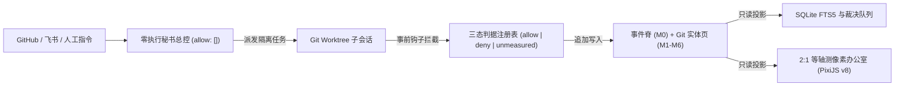

<p align="right">
  <a href="./README.md">English</a> · <strong>简体中文</strong>
</p>

# dsh-secretary

**治理优先的自治 Coding Agent 底座** —— 追加式 `M0–M6` 记忆脊、三态事前硬闸、物理零执行秘书编排，以及基于 PixiJS v8 的 2:1 等轴测像素办公室。

> 基于 MIT 协议的 [DeepSeek Harness (DSH)](https://www.deepseek.com/en/harness/) 扩展接口（`dsh-superagent` 原型）深度重构，独立建设治理判局、证据记忆脊、隔离执行与可视化观测体系（`224` 个 TypeScript 模块，`90` 套 Vitest 测试集）。

<p align="center">
  
  <br />
  <sub>2:1 等轴测 PixiJS v8 像素办公室 —— 实时裁决队列、Worktree 子会话与记忆脊的只读投影</sub>
</p>

---

## 为什么需要这套架构

长周期自治 Coding Agent 在工程落地中常出现三类结构性失效：
1. **自报完成失真** —— 工作子代理宣称“测试全部通过”，实则留下未记录的副作用、失效基准或静默回退。
2. **状态与看板漂移** —— SQLite 缓存、前端面板或提示词脱离 Git 与真实会话日志独立演化，产生第二份真相。
3. **总控会话越权** —— 持有 Shell/文件写入工具的总控编排器最终会绕过隔离边界，直接对工作区做临时改动。

`dsh-secretary` 从系统结构上对这三类问题施加硬边界：



## 核心工程决策

- **两类真相源与只读投影律**（`src/spine/`、`src/memory/`、`src/projection/`）
  - 定义真相只存于唯一注册表；发生真相只存于追加式会话日志、`M0` 事件脊以及通过 `source_ref` 序号溯源的 Git 实体页（`M1–M6`）。
  - SQLite FTS 索引、治理看板、额度账本与像素办公室前端均为**可删可重建的只读投影**，严禁反向回写真源。
- **三态事前硬闸**（`src/judgement/`、`src/executor/pre-execute-gates.ts`、`src/executor/git-workspace-snapshot.ts`）
  - 判据不进注册表即不存在，统一挂载至可扩展 `scope.stage` 节点，在危险动作执行前判定。
  - 统一返回 `allow | deny(blockers) | unmeasured`；缺输入、Shell 盲区、超时或解析失败**必须返回 `unmeasured`，严禁洗白为 `allow`**。
  - 每个判据均配备红/绿双向夹具及禁用变异测试，杜绝装饰性门禁。
- **秘书物理零执行**（`src/app/tools/`、`src/workspaces/worktree.ts`）
  - 秘书总控会话仅装配路由、裁决与只读查询工具，随后调用 `tools.restrict({ allow: [] })` 屏蔽全部全局执行工具；所有代码查验与修改均在独立 Git Worktree 子会话内完成。
- **2:1 等轴测像素办公室**（`src/office-app/`、`src/pixel-office/`）
  - 程序化房间蓝图（`room-blueprints.ts`、`roguelike-pcg.ts`）、PixiJS v8 多层光照与遮挡渲染（`pixi-diorama.ts`、`world-renderer.ts`），以及实时投影 Agent 状态、裁决与 Token 遥测的位图 HUD。

## 目录结构速览

| 目录 | 职责 |
| :--- | :--- |
| `src/spine/` | 追加式事件脊（`M0`），入脊与截断前统一脱敏 |
| `src/memory/` | Git 托管的 `M1–M6` 实体记忆页、常驻预算控制与只读 FTS5 索引 |
| `src/judgement/` | 判据注册表、三态裁决引擎、变更路径与账本一致性核验 |
| `src/executor/` | 事前完成守卫、Git 工作区快照与摘要审计 |
| `src/app/` | 零执行秘书运行时、裁决队列与常驻治理巡检 |
| `src/workspaces/` | 串行化 Git Worktree 调度、写时复制依赖隔离与 `.env` 剥离 |
| `src/office-app/` | PixiJS v8 2:1 等轴测像素办公室渲染器、房间生成器与 HUD |
| `src/rsi/` | 在线摩擦收集与 Trace-to-SOP 经验挖掘 |
| `tests/` | `90` 套 Vitest 测试，覆盖判据门禁、脱敏、Worktree、记忆不变量与 UI |
| `docs/` | 架构文档（`000-philosophy.md` – `008-cookbook.md`、`STANDARDS.md`） |

## 隔离验证与开发

所有测试均在独立临时 `DSH_HOME` 下运行，绝不触碰本机 `~/.dsh` 生产目录：

```bash
npx tsc --noEmit                                          # 严格 TypeScript 类型检查
DSH_HOME=$(mktemp -d) npx vitest run                      # 全量测试（隔离环境）
pnpm check                                                # 类型检查 + 测试 + 构建
```

安装与部署细节见 [SETUP.md](SETUP.md) 与 [docs/006-deployment.md](docs/006-deployment.md)。

## 开源协议与致谢

[MIT](LICENSE) —— 上游衍生自 DeepSeek Harness 的 MIT 开源原型 `dsh-superagent`；治理判局引擎、记忆脊、事前硬闸与像素办公室模块为独立扩展实现。
